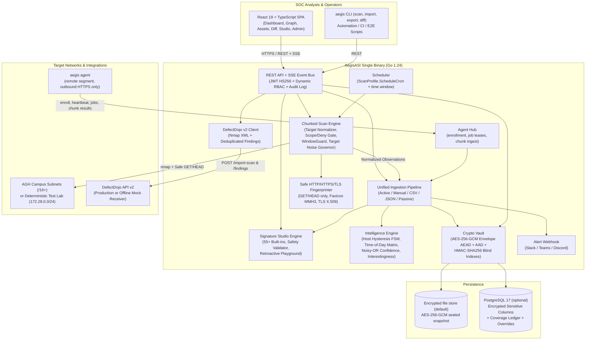
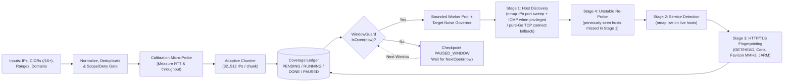
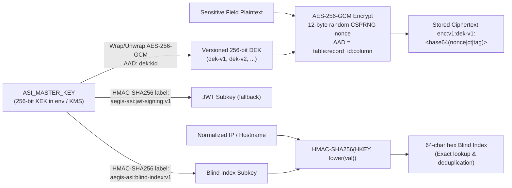
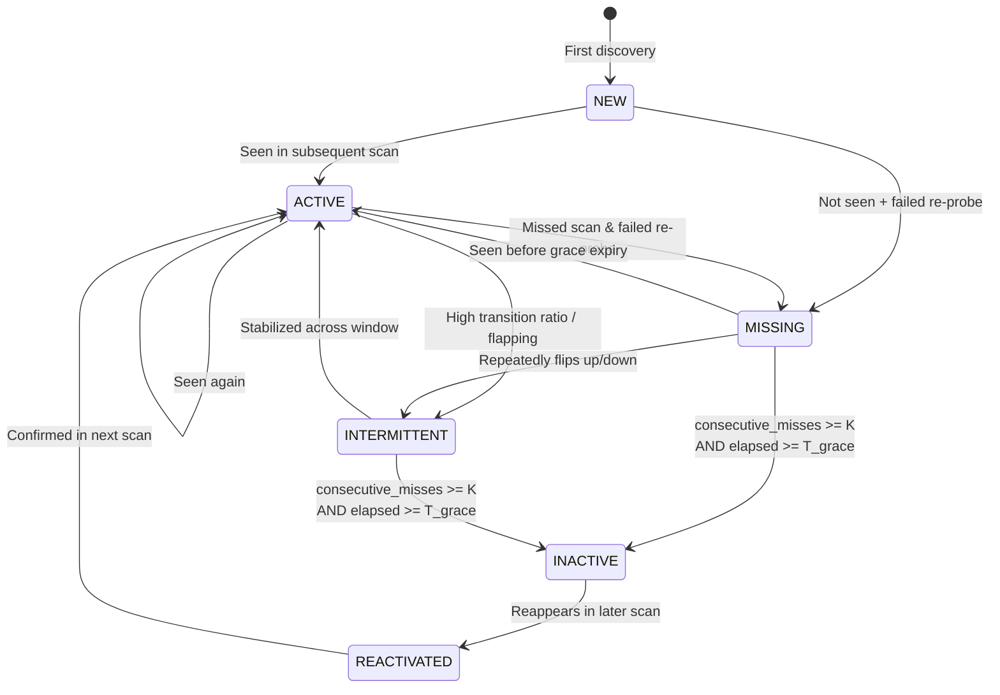

# AegisASI — System Architecture

> **Attack Surface Intelligence Platform for Centrum Bezpieczeństwa Informacji AGH (CBI AGH)**

AegisASI is a single Go binary (`aegis`) with an embedded React/TypeScript SOC dashboard. Data lives in an encrypted single-file store (`~/.aegis/aegis-store.enc`) by default, or in PostgreSQL 17 when `DATABASE_URL` is set; both apply the same per-field envelope encryption. It is purpose-built for continuous, safe, auditable attack surface discovery across large university networks (10,000–65,536+ IPs) with minimal operational overhead.

---

## 1. High-Level System Architecture

### Core Architectural Principles

1. **Unified Pipeline (Single Source of Truth):** Active network scans (`ACTIVE`), manual analyst forms (`MANUAL`), CSV/JSON imports (`IMPORT_CSV`, `IMPORT_JSON`), and passive feeds (`PASSIVE`) all normalize into identical `ObservedHost` / `ObservedService` records and execute the exact same signature matching, confidence fusion, lifecycle FSM, change detection, override preservation, and encryption pipeline.
2. **Strict Separation of Scanner Truth vs. Analyst Curation:** Scanner observations are stored as evidence receipts (`service_observations`), while analyst edits live in `asset_overrides`. Merging at read time guarantees manual edits work regardless of scan status and are **never overwritten** by subsequent scans, while surfacing *"Scanner observed: X"* diffs when reality drifts.
3. **Read-Only Discovery Safety:** All HTTP probes strictly use `GET`/`HEAD`, enforce bounded body/redirect limits (256 KB, max 5 redirects), carry an identifiable `User-Agent`, and never attempt authentication, brute-force, or mutating requests. Custom signatures pass through the **Safety Validator** before saving or executing.

---

## 2. Large-Scale Scanning (>10,000 IP), Coverage Ledger & Time Windows

- **Target Estimation (`POST /api/v1/targets/estimate`):** Expands CIDRs (e.g., `/18` = 16,384 IPs, `/16` = 65,536 IPs) with O(1) prefix arithmetic, subtracts `TargetExclusion` rules, calculates chunk counts and realistic ETA, and indicates whether the scan fits inside the configured maintenance window.
- **Hard Time Windows (`WindowGuard`):** Supports overnight windows (e.g., `22:00–06:00` in `Europe/Warsaw`). When a window expires, the engine finishes in-flight work cleanly, marks remaining chunks `PENDING`, sets the scan status to `PAUSED_WINDOW`, and resumes from the exact next `PENDING` chunk when the next window opens.
- **One rate budget, pipelined stages:** chunks flow through the stages concurrently; the profile's `max_rate_pps` is split across the concurrent nmap processes (`--max-rate`), so the sum never exceeds it. Above a size threshold chunks are built from a permuted address order, so no subnet is hit in a burst.
- **Target Noise Governor:** Tracks per-host and global token buckets. Bursts of timeouts, `429 Too Many Requests`, or TCP RST spikes automatically trigger exponential backoff and emit `governor.throttle` SSE events so university infrastructure is never overloaded.

---

## 3. Envelope Encryption At Rest (AES-256-GCM) & Blind Indexing

Every sensitive field (in PostgreSQL columns and in the file store alike: host IPs, hostnames, domains, OS guesses, banners, HTTP headers, cookies, body snippets, TLS certificates, raw Nmap XML, analyst overrides, user emails, and DefectDojo API tokens) is encrypted at the application layer before leaving Go memory.

### Cryptographic Properties

| Property | Implementation | Security Guarantee |
| :--- | :--- | :--- |
| **Algorithm** | AES-256-GCM (AEAD) | Confidentiality + 128-bit integrity tag per field |
| **Envelope Format** | `enc:v1:<kid>:<base64(nonce\|ct\|tag)>` | Self-describing key version for seamless online rotation |
| **Context Binding (AAD)** | `table:record_id:column` | Prevents ciphertext transplantation / row-swapping attacks inside DB |
| **DEK Storage** | `wrap:v1:<kid>:<base64(...)>` with AAD `dek:<kid>` | Database dump alone cannot unwrap DEKs without `ASI_MASTER_KEY` |
| **Exact Lookups** | HMAC-SHA256 blind index (`hosts.ip_hmac`) | Fast indexed deduplication without storing plaintext IPs |
| **Key Rotation** | `POST /api/v1/admin/crypto/rotate` | Generates `dek-v(N+1)`, re-encrypts sensitive rows under new DEK while preserving old DEKs for zero-downtime decryption |
| **Verification** | `scripts/verify_encryption.sh` + `/api/v1/admin/crypto/status` | Direct `psql` inspection proving ciphertext storage with zero plaintext leakage (PostgreSQL mode) |

---

## 4. Intelligence Engine

### 4.1 Host Lifecycle State Machine (Hysteresis + Re-Probe)

To avoid alert fatigue from transient campus devices (laptops, lab workstations, scheduled nightly shutdowns), hosts transition through a hysteresis state machine:

- **Automatic Re-Probe:** Before transitioning a previously active host to `MISSING`, Stage 4 executes `retry_unstable_count` targeted verification probes to filter transient packet loss.
- **Bayesian liveness:** each host keeps a Beta-Bernoulli availability estimate per time-of-day slot with exponential forgetting (`internal/intelligence/liveness.go`); it explains *why* a host is considered gone or merely off-hours (see `docs/RESEARCH.md`).
- **Dual-Condition Deactivation:** A host moves to `INACTIVE` only when **both** `consecutive_misses >= missing_threshold` ($K$) **and** time since `last_seen` exceeds `grace_period_hours` ($T_{\text{grace}}$).

### 4.2 Time-of-Day Availability Matrix (Heatmap)

Each host tracks availability ratios across 4 daily UTC/local slots:
- `00-06` (Night)
- `06-12` (Morning)
- `12-18` (Afternoon)
- `18-24` (Evening)

When a host is absent in a slot where its historical availability ratio is low (e.g., an instructional lab PC offline during `00-06`), the event is classified as `EXPECTED_OFF_HOURS` (`is_expected_schedule = true`), suppressing false alarms. Conversely, a disappearance during a normally 95%+ available slot—or an unexpected appearance at 03:00 on a normally dormant host—is flagged as `TIME_ANOMALY` (`is_time_anomaly = true`).

### 4.3 Noisy-OR Confidence Fusion & Interestingness Scoring

Multiple independent fingerprinting signals (HTTP headers, cookies, HTML generator/footer, safe-path hits, TLS SANs, Favicon MurmurHash3) are fused using the **Noisy-OR** probabilistic model:

$$C(\text{tech}) = \text{round}\left(100 \times \left(1 - \prod_{i=1}^{n} (1 - w_i)\right)\right)$$

where each matched evidence receipt $i$ contributes a calibrated weight $w_i \in [0.10, 0.98]$. Every technology badge stores the exact list of `TechEvidence` receipts (`signal_type`, `detail`, `weight`) so analysts can audit *why* a technology was reported.

**Interestingness Score (0–100)** prioritizes SOC triage by summing explainable `InterestingnessFactor` points:
- Exposed admin panels (`/admin`, Grafana, phpMyAdmin, Jenkins, Keycloak)
- Non-production environments (`staging`, `dev`, `test`, debug headers such as `X-Debug-Token` / `X-Staging-Debug`)
- Missing HTTP security headers and insecure cookies (`missing_httponly`, `missing_secure`)
- Self-signed, expired, or expiring-soon (<30 days) TLS certificates
- Unexpected time-of-day anomalies or newly opened services
- Networked IoT devices (printers, cameras, BMCs) on campus VLANs

---

## 5. Attack Surface Graph, Service Clustering & DefectDojo v2

- **Interactive Attack Surface Graph (`GET /api/v1/graph`):** Models directed topology `Scope → Host (lifecycle state) → Service (port/proto) → Technology / Matched Signature`, enabling analysts to filter by risk score, lifecycle state, or exposure category.
- **Similar Service Clustering (`GET /api/v1/clusters`):** Groups services sharing identical `favicon_mmh3` (Shodan-compatible base64-with-newlines MurmurHash3), technology stack, HTTP `<title>`, or TLS certificate issuer to spot shadow IT clones or unpatched fleets at a glance.
- **DefectDojo API v2 Integration:**
  - `POST /api/v2/import-scan/` uploads aggregated raw Nmap XML (`scan_type="Nmap Scan"`) linked to a target `engagement`.
  - `POST /api/v2/findings/` selectively pushes curated services or change events with full evidence receipts, severity mapping, and deterministic `unique_id_from_tool` deduplication keys.
  - For offline demos or staging verification, `lab-defectdojo-mock` implements the exact DefectDojo v2 contract plus a live HTML viewer at `http://localhost:18000/ui`.

---

## 6. Remote Scanning Agents & Scheduler

- **`aegis agent`** runs the same `scanner.Engine` inside a network segment the server cannot reach. It only opens outbound HTTPS to the server: one-time enrollment token, heartbeat, long-polled job leases, per-chunk results ingested through the same `ingest.Pipeline` (disappearance detection scoped to the chunk's IPs), and checkpoint resume after restarts. Protocol and security model: [DEPLOYMENT.md, section 0a](./DEPLOYMENT.md).
- **Scheduler** (`internal/scheduler`) fires profiles with `schedule_cron`; a slot that falls outside the profile's time window is deferred to the next window opening, and a profile never has two active runs.
