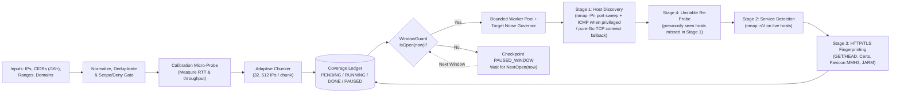
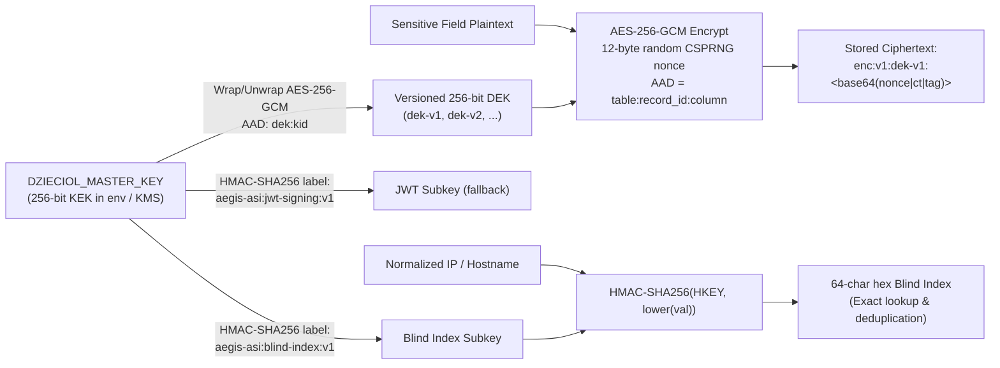
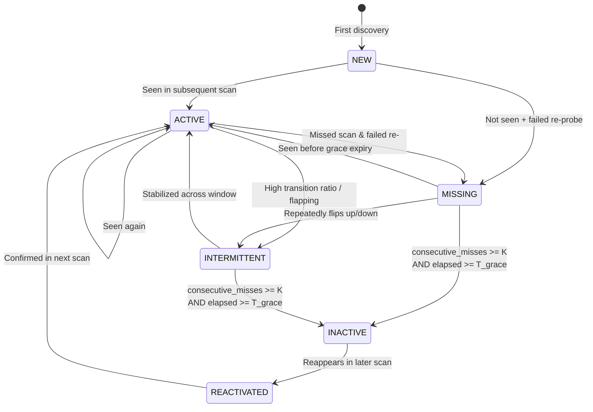

# Dzięcioł: system architecture

> Attack surface intelligence platform for Centrum Bezpieczeństwa Informacji AGH (CBI AGH)

Dzięcioł is a single Go binary (`dzieciol`) with an embedded React/TypeScript SOC dashboard. Data lives in an encrypted single-file store (`~/.dzieciol/dzieciol-store.enc`) by default, or in PostgreSQL 17 when `DATABASE_URL` is set; both apply the same per-field envelope encryption. It is built for continuous, safe and auditable attack surface discovery across large university networks (10,000-65,536+ IPs) with little operational overhead.

---

## 1. High-level system architecture

### Core principles

1. One pipeline, one source of truth. Active network scans (`ACTIVE`), manual analyst forms (`MANUAL`), CSV/JSON imports (`IMPORT_CSV`, `IMPORT_JSON`) and passive feeds (`PASSIVE`) all normalize into the same `ObservedHost` / `ObservedService` records and go through the same signature matching, confidence fusion, lifecycle FSM, change detection, override preservation and encryption.
2. Scanner truth and analyst curation stay separate. Scanner observations are stored as evidence receipts (`service_observations`), analyst edits live in `asset_overrides`, and the two are merged at read time. Manual edits therefore work regardless of scan status and later scans never overwrite them; when reality drifts from an edit, the merge surfaces a *"Scanner observed: X"* diff.
3. Discovery is read-only. HTTP probes use only `GET`/`HEAD`, cap body size and redirects (256 KB, max 5 redirects), send an identifiable `User-Agent`, and never attempt authentication, brute force or mutating requests. Custom signatures pass the Safety Validator before they are saved or executed.

---

## 2. Large-scale scanning (>10,000 IP), Coverage Ledger and time windows

- Target estimation (`POST /api/v1/targets/estimate`) expands CIDRs (e.g. `/18` = 16,384 IPs, `/16` = 65,536 IPs) with O(1) prefix arithmetic, subtracts `TargetExclusion` rules, calculates chunk counts and a realistic ETA, and says whether the scan fits inside the configured maintenance window.
- Hard time windows (`WindowGuard`) can span midnight (e.g. `22:00-06:00` in `Europe/Warsaw`). When a window expires, the engine finishes in-flight work cleanly, marks the remaining chunks `PENDING`, sets the scan status to `PAUSED_WINDOW`, and resumes from the next `PENDING` chunk when the next window opens.
- One rate budget, pipelined stages: chunks flow through the stages concurrently, and the profile's `max_rate_pps` is split across the concurrent nmap processes (`--max-rate`), so the sum never exceeds it. Above a size threshold, chunks are built from a permuted address order so no subnet is hit in a burst.
- The Target Noise Governor tracks per-host and global token buckets. Bursts of timeouts, `429 Too Many Requests` or TCP RST spikes trigger exponential backoff and emit `governor.throttle` SSE events, so the scan does not overload university infrastructure.

---

## 3. Envelope encryption at rest (AES-256-GCM) and blind indexing

Every sensitive field (in PostgreSQL columns and in the file store alike: host IPs, hostnames, domains, OS guesses, banners, HTTP headers, cookies, body snippets, TLS certificates, raw Nmap XML, analyst overrides, user emails, and DefectDojo API tokens) is encrypted at the application layer before leaving Go memory.

### Cryptographic properties

| Property | Implementation | Security Guarantee |
| :--- | :--- | :--- |
| **Algorithm** | AES-256-GCM (AEAD) | Confidentiality + 128-bit integrity tag per field |
| **Envelope Format** | `enc:v1:<kid>:<base64(nonce\|ct\|tag)>` | Self-describing key version for online rotation |
| **Context Binding (AAD)** | `table:record_id:column` | Prevents ciphertext transplantation / row-swapping attacks inside DB |
| **DEK Storage** | `wrap:v1:<kid>:<base64(...)>` with AAD `dek:<kid>` | Database dump alone cannot unwrap DEKs without `DZIECIOL_MASTER_KEY` |
| **Exact Lookups** | HMAC-SHA256 blind index (`hosts.ip_hmac`) | Fast indexed deduplication without storing plaintext IPs |
| **Key Rotation** | `POST /api/v1/admin/crypto/rotate` | Generates `dek-v(N+1)`, re-encrypts sensitive rows under new DEK while preserving old DEKs for zero-downtime decryption |
| **Verification** | `scripts/verify_encryption.sh` + `/api/v1/admin/crypto/status` | Direct `psql` inspection proving ciphertext storage with zero plaintext leakage (PostgreSQL mode) |

---

## 4. Intelligence Engine

### 4.1 Host lifecycle state machine (hysteresis + re-probe)

To avoid alert fatigue from transient campus devices (laptops, lab workstations, scheduled nightly shutdowns), hosts move through a hysteresis state machine:

- Automatic re-probe: before a previously active host goes to `MISSING`, Stage 4 runs `retry_unstable_count` targeted verification probes to filter out transient packet loss.
- Bayesian liveness: each host keeps a Beta-Bernoulli availability estimate per time-of-day slot with exponential forgetting (`internal/intelligence/liveness.go`). It explains *why* a host is considered gone or merely off-hours (see `docs/RESEARCH.md`).
- Dual-condition deactivation: a host moves to `INACTIVE` only when both `consecutive_misses >= missing_threshold` ($K$) and the time since `last_seen` exceeds `grace_period_hours` ($T_{\text{grace}}$).

### 4.2 Time-of-day availability matrix (heatmap)

Each host tracks availability ratios across 4 daily UTC/local slots:
- `00-06` (Night)
- `06-12` (Morning)
- `12-18` (Afternoon)
- `18-24` (Evening)

When a host is absent in a slot where its historical availability ratio is low (e.g. an instructional lab PC offline during `00-06`), the event is classified as `EXPECTED_OFF_HOURS` (`is_expected_schedule = true`) and raises no alarm. A disappearance during a slot where the host is normally 95%+ available, or an unexpected appearance at 03:00 on a normally dormant host, is flagged as `TIME_ANOMALY` (`is_time_anomaly = true`).

### 4.3 Noisy-OR confidence fusion and interestingness scoring

Independent fingerprinting signals (HTTP headers, cookies, HTML generator/footer, safe-path hits, TLS SANs, Favicon MurmurHash3) are fused with the Noisy-OR probabilistic model:

$$C(\text{tech}) = \text{round}\left(100 \times \left(1 - \prod_{i=1}^{n} (1 - w_i)\right)\right)$$

where each matched evidence receipt $i$ contributes a calibrated weight $w_i \in [0.10, 0.98]$. Every technology badge stores the exact list of `TechEvidence` receipts (`signal_type`, `detail`, `weight`) so analysts can audit *why* a technology was reported.

The Interestingness Score (0-100) orders SOC triage by summing explainable `InterestingnessFactor` points for:
- Exposed admin panels (`/admin`, Grafana, phpMyAdmin, Jenkins, Keycloak)
- Non-production environments (`staging`, `dev`, `test`, debug headers such as `X-Debug-Token` / `X-Staging-Debug`)
- Missing HTTP security headers and insecure cookies (`missing_httponly`, `missing_secure`)
- Self-signed, expired, or expiring-soon (<30 days) TLS certificates
- Unexpected time-of-day anomalies or newly opened services
- Networked IoT devices (printers, cameras, BMCs) on campus VLANs

---

## 5. Attack surface graph, service clustering and DefectDojo v2

- The interactive attack surface graph (`GET /api/v1/graph`) models the directed topology `Scope → Host (lifecycle state) → Service (port/proto) → Technology / Matched Signature`, so analysts can filter by risk score, lifecycle state or exposure category.
- Similar-service clustering (`GET /api/v1/clusters`) groups services that share a `favicon_mmh3` (Shodan-compatible base64-with-newlines MurmurHash3), technology stack, HTTP `<title>` or TLS certificate issuer, which makes shadow IT clones and unpatched fleets easy to spot.
- DefectDojo API v2 integration (`internal/defectdojo`). Everything goes through `POST /api/v2/reimport-scan/` with `auto_create_context` into one product type / product / engagement (names as in the secureCodeBox hook, see `docs/SECURECODEBOX.md`). Test layout inside the engagement:
  - `Dzięcioł Nmap: <profile>`: the raw merged Nmap XML of each run (`scan_type="Nmap Scan"`), one test per scan profile, reimported with `close_old_findings` so closed ports are mitigated. This is the raw record of what that profile's scope looked like.
  - `Dzięcioł changes`: a single Generic Findings test with the actionable change findings of the whole inventory (risky exposures, admin panels, staging, end of life, known vulnerabilities, verified checks, new services, gone hosts, zone policy violations), each with the owner from the CIDR rules. Every host is in it once, however many profiles cover it, so overlapping profiles (a quick /22 inside the nightly /18) and renamed profiles never produce the same finding twice. It is reimported after every completed run, triage change and scan-verified fix with `close_old_findings=true`: a condition that still holds is the same finding (stable title, description and `unique_id_from_tool`), a fixed one is mitigated with the date, a returning one is reactivated. After the reimport the analyst decisions made in Dzięcioł are mirrored (false positive to `false_p`, accepted risk to `risk_accepted` with the reason and expiry as a note); a false positive or risk acceptance set directly in DefectDojo is left alone. Dzięcioł remembers the test id and reimports by id, so renaming the test in DefectDojo is harmless.
  - `Dzięcioł observations`: services pushed by hand from the UI, never closed automatically.
  - Upgrade from per-profile change tests: older versions kept one `Dzięcioł changes: <profile>` test per profile. The first sync after the upgrade reuses the one that already holds most of today's findings as `Dzięcioł changes` (renamed, its findings keep their ids, notes and JIRA links). Every other `Dzięcioł changes: ...` test of the product is closed by an empty reimport, after its analyst notes and DefectDojo-side false positive / risk accepted states on findings that are still current were copied to the matching finding of the change test; its version reads `superseded by test #N (Dzięcioł changes)` and its description explains why. Admin → DefectDojo lists the closed tests. The same check runs on every sync, so a per-profile test written later (an old binary, an integration run) is closed too.
  - For offline demos or staging verification, `lab-defectdojo-mock` implements the DefectDojo v2 contract plus a live HTML viewer at `http://localhost:18000/ui`.

---

## 6. Remote scanning agents and scheduler

- `dzieciol agent` runs the same `scanner.Engine` inside a network segment the server cannot reach. It only opens outbound HTTPS to the server: one-time enrollment token, heartbeat, long-polled job leases, per-chunk results ingested through the same `ingest.Pipeline` (disappearance detection scoped to the chunk's IPs), and checkpoint resume after restarts. Protocol and security model: [DEPLOYMENT.md, section 0a](./DEPLOYMENT.md).
- The scheduler (`internal/scheduler`) fires profiles with `schedule_cron`. A slot that falls outside the profile's time window is deferred to the next window opening, and a profile never has two active runs.
